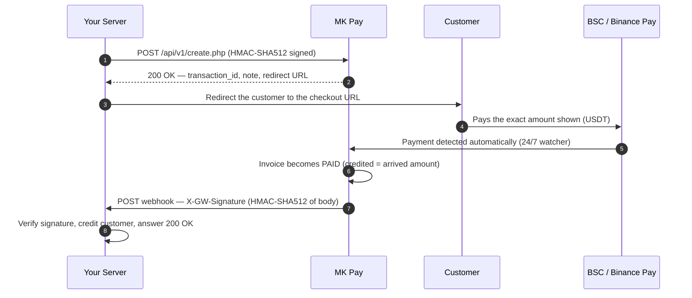

<p align="center">
  
</p>

<h1 align="center">MK Pay — Merchant API</h1>

<p align="center">
  <b>Accept USDT (BEP20 / Binance Pay) payments on any website.</b><br>
  One endpoint to create an invoice, one signed webhook to get confirmed — no SDKs, no handshakes.<br>
  Official integrations: <b>GSMTheme · Dhru Fusion · WooCommerce · Universal PHP Kit</b>
</p>

---

## Table of contents

- [About MK Pay](#about-mk-pay)
- [How a payment works](#how-a-payment-works)
- [Key facts](#key-facts)
- [Requirements](#requirements)
- [Choose your integration path](#choose-your-integration-path)
- [Installation guides](#installation-guides)
  - [1. GSMTheme module](#1-gsmtheme-module)
  - [2. Dhru Fusion module](#2-dhru-fusion-module)
  - [3. WooCommerce plugin](#3-woocommerce-plugin)
  - [4. Universal PHP Kit](#4-universal-php-kit)
- [Direct HTTP API reference](#direct-http-api-reference)
  - [Base URL](#base-url)
  - [Credentials](#credentials)
  - [Authentication](#authentication)
  - [Create Invoice](#create-invoice)
  - [Error codes](#error-codes)
  - [Webhooks](#webhooks)
  - [The arrived-amount policy](#the-arrived-amount-policy)
- [Security best practices](#security-best-practices)
- [Full PHP examples](#full-php-examples)
- [Testing checklist](#testing-checklist)
- [FAQ](#faq)
- [Support](#support)
- [License](#license)

---

## About MK Pay

MK Pay is a multi-merchant USDT payment gateway. Merchants create invoices from their own
servers, customers pay on a hosted checkout page using a BEP20 transfer from any wallet
(Trust Wallet, MetaMask, an exchange withdrawal) or through Binance Pay with a 6-digit
note, and the payment is detected automatically on the BSC chain and on Binance Pay —
24/7, with no manual confirmation step.

The moment a payment is confirmed, MK Pay sends a signed JSON webhook to the merchant's
notify URL so the customer can be credited automatically. Every request and every webhook
is authenticated with HMAC-SHA512 signatures, so both sides can trust the data end to end.
A merchant panel at [pay.gsmsudan.com](https://pay.gsmsudan.com) provides API credentials,
gateway management, the Transactions list, and a Webhook settings page.

This repository contains the **official documentation** for the MK Pay Merchant API and
for the four ready-made integration modules. The modules themselves are downloaded from
the official site, so integrators always get the latest tested build.

## How a payment works



In five words: **create, redirect, detect, confirm, webhook.** Your server only does two
things — call the Create Invoice endpoint and handle the webhook. Everything else
(amount display, payment-method choice, blockchain watching, confirmation) is handled by
MK Pay on the checkout page.

## Key facts

| Item | Value |
|---|---|
| Currency | USDT only — BEP20 (BSC) and Binance Pay C2C |
| API version | v1 |
| Create-invoice endpoint | `POST https://pay.gsmsudan.com/api/v1/create.php` |
| Request authentication | HMAC-SHA512 headers (see [Authentication](#authentication)) |
| Webhook authentication | `X-GW-Signature` — HMAC-SHA512 of the raw body |
| Rate limit (API) | 60 requests per minute per merchant |
| Confirmation time | Usually within a few minutes of the customer paying |
| Transport | All endpoints are server-to-server over HTTPS |

## Requirements

To integrate a site with MK Pay you need the following, all of which come from your
merchant account rather than from this repository:

- A **merchant account** on [pay.gsmsudan.com](https://pay.gsmsudan.com) with an **active subscription** (expired plans receive `403 subscription_required`).
- Your **API Key** and **API Secret**, shown on the *Account & API* page of the panel.
- At least one **active payment gateway** (a BEP20 gateway, or Binance Pay with a QR configured) on the *Gateways* page.
- A server with **HTTPS** enabled — API calls are server-to-server only, and webhook URLs must be reachable by MK Pay.
- For PHP integrations: PHP 7.4+ with the **cURL** extension (used by the official modules and examples).

## Choose your integration path

| Your platform | Use this | Package |
|---|---|---|
| GSMTheme (Laravel script) | GSMTheme module | [gsmtheme-module.zip](https://pay.gsmsudan.com/modules/gsmtheme-module.zip) |
| Dhru Fusion / Dhru Fusion Pro | Dhru module | [dhru-module.zip](https://pay.gsmsudan.com/modules/dhru-module.zip) |
| WordPress + WooCommerce | WooCommerce plugin | [mkpay-woocommerce.zip](https://pay.gsmsudan.com/modules/mkpay-woocommerce.zip) |
| Any custom PHP site / panel / tailor-made store | Universal PHP Kit | [mkpay-universal-php.zip](https://pay.gsmsudan.com/modules/mkpay-universal-php.zip) |
| Anything else (Node, Python, …) | Direct HTTP API | this document |

These four integrations — **GSMTheme, Dhru, WooCommerce and the Universal PHP Kit** —
are the official, fully-supported set. Any other platform can always integrate through
the Universal PHP Kit or the direct HTTP API documented below. You only need the raw API
when your platform cannot run one of the ready-made modules.

## Installation guides

### 1. GSMTheme module

A drop-in payment gateway class for websites running the GSMTheme script.

1. Download [`gsmtheme-module.zip`](https://pay.gsmsudan.com/modules/gsmtheme-module.zip) and extract `MkPay.php`.
2. Upload it to your site at `app/Services/Gateway/MkPay.php` (via your File Manager).
   **The file name must be exactly `MkPay.php`** (capital M, capital P, lower-case k).
   Keep only ONE copy of this file in `app/Services/Gateway/` — if a differently-cased
   variant (for example `MKPay.php`) was uploaded previously, delete it, otherwise the
   gateway appears TWICE in the admin panel.
3. Admin panel → **Payment Gateways** → add a new gateway.
4. Gateway Class: `MkPay` — then fill in the gateway fields:
   - **MK Pay URL** — `https://pay.gsmsudan.com` (no trailing slash)
   - **API Key** — from your MK Pay panel → *Account & API*
   - **API Secret** — from your MK Pay panel → *Account & API*
5. Keep the module's `min_limit` / `max_limit` in sync with your MK Pay limits.

**Verification method.** The module is webhook-based (server-to-server). The theme
receives MK Pay at the standard GSMTheme route
`/public/api/gateway-webhook/{base64 of the gateway class name}` — the last segment is
simply the base64 encoding of the gateway class. For example, a gateway class named
`Example` would be addressed at `.../gateway-webhook/RXhhbXBsZQ==`. MK Pay signs every
payment notification with your API Secret
(`X-GW-Signature` header, HMAC-SHA512 of the raw body), and the module verifies the
signature **before** crediting anyone, so forged calls are rejected. The signature is
what makes the webhook trustworthy — the URL itself is only a routing address, not a
secret.

**No manual webhook setup.** The module sends its own `notify_url` (your site's webhook
route) to MK Pay with every payment request — each merchant's webhook points to their
own domain automatically. The URL shown in your gateway panel is informational only;
you never paste it anywhere in MK Pay.

### 2. Dhru Fusion module

For websites running the Dhru Fusion / Dhru Fusion Pro script.

1. Download [`dhru-module.zip`](https://pay.gsmsudan.com/modules/dhru-module.zip) and unzip it.
2. Upload `mkpay.php` (the one at the zip root) to `public_html/modules/gateways/`.
3. Create the folder `public_html/modules/gateways/mkpay/`.
4. Upload `mkpay/mkpay.php` and `mkpay/.htaccess` (from inside the zip) into that folder.
5. Admin panel → **Payment Gateways** → activate **MK Pay — USDT BEP20** and fill in
   **Merchant API Key / Secret** (from MK Pay → *Account & API*). **MK Pay URL is
   optional** — leave it empty to use `https://pay.gsmsudan.com`.

Same behavior as the GSMTheme module: the webhook is fully automatic, the signature
(`X-GW-Signature`) is verified before crediting, and the customer is credited the
**arrived amount** (`amount`), never the original invoice value.

### 3. WooCommerce plugin

For stores running WordPress + WooCommerce.

1. WP admin → **Plugins** → Add New → **Upload Plugin** → pick
   [`mkpay-woocommerce.zip`](https://pay.gsmsudan.com/modules/mkpay-woocommerce.zip) → Install → Activate.
2. WooCommerce → **Settings** → **Payments** → **"MK Pay – USDT"** → enter your
   Merchant API Key & Secret → **Save**.
3. Store currency is not USD? Set the **USDT rate** field — the invoice total sent to
   MK Pay is `order total × rate`.
4. Customer checks out → the QR payment page opens → pays USDT (BEP20) from any wallet.
5. The signed webhook reaches your store → the order is marked **Paid automatically** —
   zero manual work.

### 4. Universal PHP Kit

For any website that accepts a custom payment gateway — custom PHP, panels, tailor-made
stores, anything.

1. Extract the `mkpay` folder from
   [`mkpay-universal-php.zip`](https://pay.gsmsudan.com/modules/mkpay-universal-php.zip)
   into your site, then run `install.sql` once (it creates the `payments` table).
2. Edit `mkpay/mkpay-config.php` — enter your Merchant API Key & Secret and your orders
   table (ready-made examples for common schemas are inside the file).
3. Copy the pay button from `example.php` into your checkout page — done.
4. Customer pays USDT (BEP20) from any wallet via the QR payment page.
5. The signed webhook credits the order / balance instantly.

**Built-in security (all four modules, no exceptions):**

1. **Authentication** — every API request is signed `HMAC-SHA512(ts \n nonce \n raw body)` with `X-Merchant-Key / X-Timestamp / X-Nonce / X-Signature`; every webhook is verified `hash_equals(HMAC-SHA512(raw body, secret), X-GW-Signature)` **before** any database write.
2. **Rate limiting** — webhook/callback endpoints allow max 30 requests/minute per IP; 5 invalid-signature attempts within 15 minutes ban that IP for 1 hour.
3. **Row-level security** — a webhook can only credit an order/invoice that exists in THAT store's own database; the transaction id is recorded with a `UNIQUE` index, so replayed or duplicated webhooks can never credit twice (idempotency).
4. **Server-side validation** — amounts are never taken from the browser; the webhook amount is compared with the order total stored in the local database using a float-safe margin of **0.011** (network-fee rounding never rejects a valid payment). Only `status=PAID` credits, and the customer is credited the **arrived amount**.

---

## Direct HTTP API reference

Use this section when your platform cannot run one of the ready-made modules. The API is
intentionally tiny: one endpoint to create an invoice and one webhook to receive
confirmations. Plain HTTPS, JSON and HMAC signatures — no SDKs required.

### Base URL

```
https://pay.gsmsudan.com
```

### Credentials

1. Log in to your **MK Pay merchant panel**.
2. Open **Account & API** — copy your `api_key` and `api_secret`.
3. Open the **Webhook** page and save your site's webhook URL. It is used for any
   invoice that does not carry its own `notify_url`.
4. Check **Plugins & Modules** first — if a ready-made module exists for your platform,
   use it instead of the raw API.

> **Keep your secret safe.** The `api_secret` signs every request you send and every
> webhook you receive. Store it server-side only — never in browser JavaScript, mobile
> apps or public repositories. Requests can only be made while your merchant
> subscription is active; expired plans receive `403 subscription_required`.

### Authentication

Every request must carry four HTTP headers:

| Header | Value |
|---|---|
| `X-Merchant-Key` | Your API key — identifies the merchant. |
| `X-Timestamp` | Current Unix time **in milliseconds** (e.g. `1792764428123`). |
| `X-Nonce` | A random unique string per request — e.g. 16 hex characters. |
| `X-Signature` | HMAC-SHA512 signature, computed as shown below. |

**Signature recipe**

```text
string_to_sign  =  X-Timestamp  +  "\n"  +  X-Nonce  +  "\n"  +  raw_request_body

X-Signature     =  lowercase_hex( HMAC_SHA512( key = api_secret,
                                               message = string_to_sign ) )
```

**Rules that prevent `bad_signature`:**

- **Sign the exact bytes you send.** Build the JSON string once, sign it, and POST that
  same string. Re-encoding or re-ordering fields afterwards breaks the signature.
- The timestamp must be within **±5 seconds** of the MK Pay server clock. Generate it
  immediately before sending and keep your server clock synced via NTP.
- The nonce must be unique per request. Combined with the tight 5-second window, this
  blocks replay attempts.
- All calls are **server-to-server** over HTTPS — never call the API from a browser.

**PHP — computing the signature**

```php
<?php
// $body = the exact JSON string you are about to POST
$ts  = (string) round(microtime(true) * 1000);   // milliseconds
$nc  = bin2hex(random_bytes(8));                 // random nonce
$sig = hash_hmac('sha512', $ts . "\n" . $nc . "\n" . $body, $SECRET);
```

### Create Invoice

```
POST https://pay.gsmsudan.com/api/v1/create.php
Content-Type: application/json
```

Creates a pending invoice and returns a checkout URL. Send the customer to `redirect` —
everything else (amount display, method choice, payment detection) is handled by MK Pay.

**Request body (JSON)**

| Field | Type | Required | Description |
|---|---|---|---|
| `user_id` | string | Yes | Unique customer identifier on **your** site. Allowed characters: `A-Z a-z 0-9 _ - @ .` — anything else is stripped. |
| `amount` | number | Yes | Invoice amount in USDT, up to 2 decimals. Must be within the platform's allowed range, otherwise `bad_amount`. |
| `gateway_id` | integer | No | Force a specific gateway (must be one of your active gateways). Omit to let MK Pay choose automatically. |
| `return_url` | string (URL) | No | Where the customer is sent after completing the payment. |
| `notify_url` | string (URL) | No | Per-invoice webhook override. If omitted, the webhook URL saved on your panel's **Webhook** page is used. |
| `reference` | string | No | Your own order/reference ID. Allowed: `A-Z a-z 0-9 _ -`. Returned unchanged in the webhook. |
| `customer_name` | string | No | Customer display name (max 100 chars). |
| `customer_email` | string | No | Customer email (must be a valid email format). |

**Method selection — who picks the payment method?** If `gateway_id` is provided, that
gateway is used. If omitted and you have exactly one payable method (a BEP20 gateway, or
Binance Pay with a QR configured), it is assigned automatically. If you have more than
one, the invoice is created unassigned and the **customer chooses the method on the
checkout page** — the choice then locks the invoice.

**Minimal request**

```json
{
  "user_id": "1007",
  "amount": 10.00
}
```

**Success response — HTTP 200**

```json
{
  "status": "OK",
  "transaction_id": "GP2610231145027F3A9C",
  "note": "483920",
  "redirect": "https://pay.gsmsudan.com/checkout.php?inv=9f3c8a41d2e74b06a5c1f8e3d2b4a6c8"
}
```

| Field | Description |
|---|---|
| `status` | `OK` — the invoice was created. |
| `transaction_id` | Unique invoice ID (`GP` + timestamp + random). **Store it** — it comes back in the webhook as `transaction_id`. |
| `note` | A 6-digit numeric note. Customers paying via **Binance Pay must include it as the "Note to Payee"**; it is the payment's identifier. |
| `redirect` | The checkout page URL. Redirect the customer there (HTTP 302 or a link/button). |

> **BEP20 amount tagging — never assume the exact paid amount.** For BEP20 invoices,
> MK Pay may add a unique fraction of up to `0.0999` USDT to the amount so the on-chain
> transfer can be matched automatically. The customer always pays the **exact amount
> displayed on the checkout page**. Your integration must therefore never hardcode or
> assume amounts — always read the credited amount from the webhook.

### Error codes

All responses are JSON. Authentication and transport failures use proper HTTP status
codes; two validation errors return HTTP 200 — so **always check the `error` / `status`
field in the body**, not just the status code.

| Error | HTTP | Meaning |
|---|---|---|
| `missing_headers` | 401 | One or more of the four authentication headers are missing. |
| `expired_timestamp` | 401 | `X-Timestamp` differs from the MK Pay server clock by more than 5 seconds. |
| `unknown_merchant` | 401 | The API key is invalid or the merchant account is disabled. |
| `bad_signature` | 401 | The signature does not match — see the rules in [Authentication](#authentication). |
| `subscription_required` | 403 | Your merchant plan has expired — renew it in the panel. |
| `no_active_gateway` | 422 | You have no active payment gateway. Add/activate one on the **Gateways** page. |
| `rate_limited` | 429 | More than 60 requests in 60 seconds — slow down and retry. |
| `user_id_required` | 200 * | `user_id` is missing or empty after sanitisation. |
| `bad_amount` | 200 * | `amount` is outside the platform's allowed range. |

\* Validation errors return HTTP 200 with an `error` field — inspect the response body.

**Common causes of `bad_signature`:** re-encoding the JSON after signing it · signing
the pretty-printed body but sending a minified one · using the API key instead of the
API secret · forgetting the two `\n` separators · millisecond vs second precision in
`X-Timestamp`.

### Webhooks

The moment an invoice is confirmed, MK Pay POSTs a signed JSON payload to your webhook
URL. This is how you know — with cryptographic certainty — that the payment really
happened and was really confirmed by MK Pay.

**Which URL receives the webhook?**

1. The `notify_url` sent when creating **that specific invoice** (per-invoice override) — used first if present.
2. Otherwise, the webhook URL saved on your panel's **Webhook** page.

**Delivery facts**

| Item | Value |
|---|---|
| Method | `POST`, `Content-Type: application/json` |
| Signature header | `X-GW-Signature: lowercase_hex(HMAC_SHA512(raw_body, api_secret))` |
| Timeout | 10 seconds — reply fast, defer heavy work |
| Attempts | One attempt per confirmation — keep your endpoint reachable; contact support to re-send if you missed one |
| Expected answer | HTTP `200` with the body `OK` |

**Payload fields**

| Field | Type | Description |
|---|---|---|
| `transaction_id` | string | The invoice ID — the same one returned by Create Invoice. Use it for idempotency. |
| `note` | string | The 6-digit payment note. |
| `reference` | string | Your reference, exactly as sent (`""` if none). |
| `customer` | string | The `user_id` you sent — credit **this** user. |
| `customer_name` | string | Customer name, as sent. |
| `customer_email` | string | Customer email, as sent. |
| `amount` | number | **The credited amount — what actually arrived after network fees. Credit this value.** |
| `invoice_amount` | number | The original invoice amount (informational only). |
| `currency` | string | `USDT` |
| `status` | string | `PAID` — only process payloads with this status. |
| `ts` | number | Unix timestamp of the notification. |

**Verifying the signature (PHP)**

```php
<?php
// Compare in constant time; reject anything that does not match
$raw = file_get_contents('php://input');
$sig = $_SERVER['HTTP_X_GW_SIGNATURE'] ?? '';

if (!hash_equals(hash_hmac('sha512', $raw, $SECRET), $sig)) {
    http_response_code(403);
    echo 'invalid signature';
    exit;
}
```

> **Never credit before verifying.** Anyone can POST a forged JSON payload to your
> webhook URL. Without the `X-GW-Signature` check above, an attacker credits themselves
> for free. Verify first, process second, answer `200 OK` last.

### The arrived-amount policy

USDT network fees are deducted by the network **before** the funds reach MK Pay, and
MK Pay credits **what actually arrived**. That is why `amount` (credited) can be
slightly lower than `invoice_amount` — for example an invoice of `5.0960` USDT may
arrive as `5.0860` after the network fee, and the customer must be credited `5.0860`.

Always credit the webhook field `amount`, and never validate
`amount == invoice_amount` or `amount == your order total` with strict equality — doing
so rejects perfectly valid payments and short-changes customers. The official modules
compare against the stored order total using a float-safe margin of **0.011** for
exactly this reason.

## Security best practices

- **Server-to-server only.** The `api_secret` must never appear in browser JavaScript,
  mobile apps, or public repos — anyone holding it can create invoices in your name.
- **Verify every webhook signature** with a constant-time comparison (`hash_equals` in
  PHP) before doing anything else.
- **Idempotency:** keep a unique index on `transaction_id` and skip payloads you have
  already processed — duplicates then become harmless.
- **Trust only `status: "PAID"`.** Ignore or log anything else.
- **Map before crediting:** use `reference` / `customer` to tie the payment to a real
  order on your side before adding balance.
- **Use HTTPS everywhere** — for `return_url`, `notify_url`, and your webhook endpoint.
- **Log every webhook** (raw body + your processing outcome). When something looks
  wrong, that log is the single source of truth.

## Full PHP examples

Two small PHP files are all it takes. Adapt the TODO sections to your platform.

### Creating an invoice from your server

```php
<?php
/* MK Pay — create an invoice (call this from your SERVER, never the browser) */
$API_URL = 'https://pay.gsmsudan.com/api/v1/create.php';
$API_KEY = 'YOUR_API_KEY';
$SECRET  = 'YOUR_API_SECRET';

$payload = [
    'user_id'        => '1007',                      // customer ID on YOUR site
    'amount'         => 10.00,                       // USDT, max 2 decimals
    'reference'      => 'ORDER-8891',                // optional: your order id
    'return_url'     => 'https://mysite.com/thanks.php',
    'notify_url'     => 'https://mysite.com/mkpay-webhook.php',
    'customer_name'  => 'Mohamed Ahmed',
    'customer_email' => 'mohamed@example.com',
];
$body = json_encode($payload);                     // sign EXACTLY these bytes

$ts  = (string) round(microtime(true) * 1000);     // milliseconds
$nc  = bin2hex(random_bytes(8));                   // random nonce
$sig = hash_hmac('sha512', $ts . "\n" . $nc . "\n" . $body, $SECRET);

$ch = curl_init($API_URL);
curl_setopt_array($ch, [
    CURLOPT_POST           => true,
    CURLOPT_POSTFIELDS     => $body,
    CURLOPT_RETURNTRANSFER => true,
    CURLOPT_TIMEOUT        => 15,
    CURLOPT_HTTPHEADER     => [
        'Content-Type: application/json',
        'X-Merchant-Key: ' . $API_KEY,
        'X-Timestamp: '    . $ts,
        'X-Nonce: '        . $nc,
        'X-Signature: '    . $sig,
    ],
]);
$res = json_decode((string) curl_exec($ch), true);

if (($res['status'] ?? '') === 'OK') {
    header('Location: ' . $res['redirect']);       // send customer to checkout
    exit;
}
http_response_code(400);
exit('MK Pay error: ' . ($res['error'] ?? 'unknown'));
```

### Receiving the payment webhook

```php
<?php
/* MK Pay — webhook receiver. Verify first, process second, answer last. */
$SECRET = 'YOUR_API_SECRET';

$raw = file_get_contents('php://input');
$sig = $_SERVER['HTTP_X_GW_SIGNATURE'] ?? '';

/* 1) Verify authenticity (constant-time compare) */
if (!hash_equals(hash_hmac('sha512', $raw, $SECRET), $sig)) {
    http_response_code(403);
    echo 'invalid signature';
    exit;
}

/* 2) Parse the payload */
$d = json_decode($raw, true);

/* 3) Process only confirmed payments, exactly once (idempotency) */
if (($d['status'] ?? '') === 'PAID') {
    $txn  = $d['transaction_id'];      // e.g. GP2610231145027F3A9C — unique key
    $user = $d['customer'];            // the user_id you sent
    $amt  = (float) $d['amount'];      // CREDIT THIS (arrived amount)

    // TODO: skip if $txn was already processed
    // TODO: credit $amt to user $user on your platform
}

/* 4) Always answer 2xx so MK Pay marks the delivery as accepted */
http_response_code(200);
echo 'OK';
```

**Wiring it up.** Upload `mkpay-webhook.php` to your site, then either send
`notify_url` with every invoice, or save `https://yoursite.com/mkpay-webhook.php` once
on the **Webhook** page of your MK Pay panel — every future invoice will use it
automatically.

## Testing checklist

Run one small live payment end to end before going public with your integration:

1. Copy your **API Key / Secret** from *Account & API* and store them server-side only.
2. Save your webhook URL on the **Webhook** page (or plan to send `notify_url` with every invoice).
3. From your **server** (never the browser), create a small invoice (e.g. `1.00` USDT) and confirm you get HTTP 200 with `"status": "OK"`.
4. Open the `redirect` URL and pay from any wallet (BEP20) — or via Binance Pay including the 6-digit `note` as "Note to Payee".
5. Wait for confirmation (usually a few minutes) and check that the webhook arrives, its signature verifies, and your side credits the **`amount`** value.
6. Cross-check the payment on the **Transactions** page of your MK Pay panel (`status` should be `PAID`).
7. If your site was down and the webhook was missed, contact support with the `transaction_id` to have it re-sent.

## FAQ

**Which amount should I credit my customer?**
Always `amount` — the amount that actually arrived after USDT network fees.
`invoice_amount` is informational only. This is MK Pay's arrived-amount policy and it
protects both sides from fee surprises.

**The checkout amount looks slightly different from what I requested — why?**
For BEP20 invoices MK Pay adds a unique fraction of up to `0.0999` USDT so the on-chain
transfer can be matched automatically. The customer pays the exact amount shown on the
checkout page, and the webhook tells you the final credited value.

**How long until the webhook arrives?**
Usually within a few minutes of the customer completing the transfer. BEP20 payments
wait for the required network confirmations; Binance Pay transfers are detected via the
6-digit note. Detection runs continuously — no manual step.

**My site was down and missed the webhook — what now?**
Check the invoice status on the **Transactions** page of your MK Pay panel, then contact
support with the `transaction_id` to have the notification re-sent. To stay safe in the
future, design your receiver to answer `200 OK` within 10 seconds and defer heavy work.

**Why do I keep getting `expired_timestamp`?**
Your server clock drifts more than 5 seconds from MK Pay's clock. Enable NTP time
synchronisation on your server and generate the timestamp immediately before each
request.

**Can I call the API from the browser or a mobile app?**
No. The `api_secret` would be exposed and anyone could create invoices in your name.
Always call the API from your server; the browser only ever sees the `redirect` URL.

**Does MK Pay retry failed webhook deliveries?**
Currently one attempt is made per confirmation. Keep your endpoint online and fast,
monitor your logs, and contact support with the transaction ID if a delivery was missed.

## Support

Need help with your integration? Contact MK Pay support through the channels provided
with your merchant account — and always include the `transaction_id` so the payment can
be located immediately.

- Website: [pay.gsmsudan.com](https://pay.gsmsudan.com)
- Styled HTML version of this documentation: [api-docs.html](api-docs.html)

## License

Released under the [MIT License](LICENSE).
